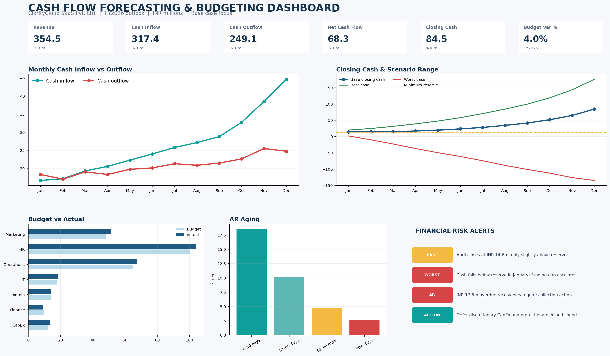

# Cash Flow Forecasting & Budgeting Model

A practical, non-coding **Excel / Power BI-ready FP&A project** for forecasting liquidity, preparing budgets, comparing Budget vs Actual, identifying cash shortages and supporting management decisions.

> **Portfolio note:** This repository contains a fully populated Excel model, 228 transaction records, forecast snapshots, a dashboard screenshot, documentation, formulas and management storytelling. All numbers are illustrative and stated in **INR millions** unless noted otherwise.



## 1. Project Overview

### What the model solves

Cash flow forecasting estimates when cash will be received and paid, then rolls the movement into a future opening and closing cash balance. Budgeting converts management plans into approved financial targets. Together, they help Finance/FP&A answer: *Will the business have enough cash to operate, invest and meet obligations? Where are we missing plan? What action should management take now?*

Companies prepare budgets to allocate resources, set targets, control costs, plan hiring and CapEx, coordinate departments, support funding decisions and create a baseline for performance measurement.

| Term | Meaning in this project |
|---|---|
| **Budget** | Approved plan prepared before the period; the control baseline. |
| **Forecast** | Best current estimate of what will happen using actual performance and updated assumptions. |
| **Actual** | Recorded result from transactions, bank statements, invoices or the ERP. |
| **Cash flow** | Timing of cash received and cash paid. |
| **Profit** | Revenue recognized less accounting expenses; it may include non-cash items and revenue not yet collected. |

A profitable company can still face a cash shortage when customers pay late, inventory or CapEx is paid before revenue is collected, debt repayments are due, or rapid growth consumes working capital. Financial Analysts use a cash forecast to identify the month and cause of a potential funding gap. FP&A teams use Budget vs Actual analysis to investigate root causes, update the forecast, assign owners and improve the next planning cycle.

These models are used by SaaS, manufacturing, retail, e-commerce, professional services, healthcare, logistics, infrastructure, startups, SMEs, MNCs, consulting firms and treasury teams. This project demonstrates Excel modelling, data preparation, financial statement logic, cash flow classification, revenue and expense forecasting, variance analysis, AR/AP, working capital, scenario modelling, dashboard design and management communication.

## 2. Company Scenario

- **Company:** ClarityCloud SaaS Pvt. Ltd.
- **Industry:** B2B software-as-a-service for logistics and retail companies in India.
- **Business model:** Annual and monthly subscriptions, implementation fees and support services.
- **Revenue sources:** Subscription ARR/MRR, implementation and onboarding fees, customer advances and minor other income.
- **Major expenses:** Payroll, cloud/software, marketing, implementation vendors, rent, utilities, administration, travel and CapEx.
- **Customer payment cycle:** Typical 60-day B2B terms; customer advances are collected for implementation.
- **Supplier payment cycle:** Normally 30 days; strategic vendors are managed within agreed terms.
- **Current cash position:** INR **16.2m at 31-Dec-2025**, used as FY2026 opening cash.
- **Financial year:** FY2025 historical actuals; FY2026 monthly forecast.
- **Management objectives:** Maintain at least INR 12.0m reserve, grow revenue, reduce DSO, avoid emergency borrowing, protect payroll/cloud service continuity and stage discretionary CapEx.

## 3. Dataset

`data/cash_flow_transactions.csv` contains **228 analysis-ready records**: 19 transaction lines × 12 months. Fields include:

`Transaction ID, Date, Month, Quarter, Department, Category, Subcategory, Transaction Type, Cash Inflow, Cash Outflow, Budget Amount, Actual Amount, Forecast Amount, Revenue, Operating Expense, Capital Expenditure, Accounts Receivable, Accounts Payable, Opening Cash Balance, Closing Cash Balance, Variance Amount, Variance %, Payment Status, Cost Center, Remarks`

The same CSV can be loaded into Excel, Power BI, Tableau, SQL or Python. `data/data_dictionary.csv` documents definitions and validation rules. `data/data_quality_examples.csv` provides intentionally imperfect examples for a cleaning exercise.

Sample record:

```csv
Transaction ID,Date,Month,Quarter,Department,Category,Subcategory,Transaction Type,Cash Inflow,Cash Outflow,Budget Amount,Actual Amount,Forecast Amount
TXN-0001,08-Jan-2025,Jan-2025,Q1,Sales,Operating Activities,Customer Collections,Inflow,12.50,0.00,13.13,12.50,13.75
```

### Historical cash flow structure

- **Operating activities:** Customer Collections, Customer Advances, Other Income, Salaries, Rent, Marketing, Utilities, Software, Administration, Vendor Payments and Travel.
- **Investing activities:** Equipment Purchases and Technology Investment.
- **Financing activities:** Loan Proceeds, Loan Repayment, Equity Funding and Interest Payments.

Inflows increase cash. Operating, investing and financing outflows reduce cash. Loan proceeds and equity funding increase cash but have different strategic consequences: debt creates repayment/interest obligations; equity does not create scheduled repayment but dilutes ownership.

## 4. Data Cleaning Methodology

The workbook uses a cleaned dataset. The implementation guide in `docs/Project_Guide.md` gives the full procedure. The core checks are:

1. Remove duplicate `Transaction ID` records after checking date, amount, source document and vendor/customer.
2. Standardize dates to true date values and derive `Month` and `Quarter` from the date.
3. Convert currency text such as `₹15,200,000`, `INR 3,500,000` or `1,200,000` into numeric INR millions.
4. Map department aliases such as `Human Resources` → `HR`, `Marketing ` → `Marketing` and `Ops` → `Operations`.
5. Keep `Cash Inflow` and `Cash Outflow` as positive magnitudes; use `Transaction Type` to determine direction.
6. Validate `Actual Amount = Cash Inflow + Cash Outflow` and ensure only the appropriate direction column is populated.
7. Fill missing categories only from a source document or send them to a review queue—do not guess silently.
8. Flag unusual records such as a software payment near INR 1,000m using an outlier threshold and source-invoice review.
9. Validate budget and actual values against approved budget files, invoices and bank statements.
10. Reconcile monthly totals to the bank/GL and confirm opening cash + net cash flow = closing cash.

Before-and-after examples are stored in `data/data_quality_examples.csv`; examples include duplicate candidates, mixed date formats, negative outflow signs, missing category, currency text and an outlier.

## 5. FY2026 Cash Flow Forecast

The model calculates:

```text
Net Cash Flow = Total Cash Inflows - Total Cash Outflows
Closing Cash Balance = Opening Cash Balance + Net Cash Flow
```

Base-case monthly view generated by the model:

| Month | Opening Cash | Cash Inflows | Cash Outflows | Net Cash Flow | Closing Cash | Alert |
|---|---:|---:|---:|---:|---:|---|
| Jan-26 | 16.20 | 16.67 | 18.32 | (1.65) | 14.55 | Watch |
| Feb-26 | 14.55 | 17.15 | 17.03 | 0.13 | 14.68 | Watch |
| Mar-26 | 14.68 | 19.30 | 19.04 | 0.26 | 14.94 | Watch |
| Apr-26 | 14.94 | 20.55 | 18.33 | 2.22 | 17.16 | Healthy |
| May-26 | 17.16 | 22.28 | 19.75 | 2.53 | 19.69 | Healthy |
| Jun-26 | 19.69 | 23.99 | 20.14 | 3.85 | 23.54 | Healthy |
| Jul-26 | 23.54 | 25.77 | 21.29 | 4.48 | 28.02 | Healthy |
| Aug-26 | 28.02 | 27.14 | 20.86 | 6.27 | 34.30 | Healthy |
| Sep-26 | 34.30 | 28.77 | 21.48 | 7.29 | 41.59 | Healthy |
| Oct-26 | 41.59 | 32.74 | 22.62 | 10.12 | 51.71 | Healthy |
| Nov-26 | 51.71 | 38.47 | 25.49 | 12.97 | 64.68 | Healthy |
| Dec-26 | 64.68 | 44.58 | 24.74 | 19.84 | 84.53 | Healthy |

The Base Case is above the INR 12m reserve but is on **Watch** in January–March. Management should not wait for a negative closing balance; early actions are cheaper.

## 6. Budget Model and Budget vs Actual

The model includes annual and monthly budgets for Sales, Marketing, HR, Operations, IT, Administration, Finance and CapEx. FY2025 summary:

| Department / line | Budget | Actual | Variance (Actual - Budget) | Interpretation |
|---|---:|---:|---:|---|
| Sales revenue | 225.00 | 232.80 | 7.80 | Favorable revenue beat |
| Marketing | 48.00 | 51.50 | 3.50 | Unfavorable expense overrun |
| HR | 100.00 | 103.90 | 3.90 | Unfavorable expense overrun |
| Operations | 65.00 | 67.30 | 2.30 | Unfavorable expense overrun |
| IT | 18.00 | 18.35 | 0.35 | Slightly unfavorable |
| Administration | 14.00 | 14.05 | 0.05 | Within plan |
| Finance | 10.00 | 9.20 | (0.80) | Favorable expense underspend |
| Capital Expenditure | 12.00 | 13.50 | 1.50 | Unfavorable CapEx overrun |

```text
Variance = Actual - Budget
Variance % = (Actual - Budget) / Budget
```

A positive revenue variance is normally favorable. A positive expense variance is normally unfavorable. A negative expense variance can be favorable, but only after confirming that service levels, hiring, security and delivery were not compromised. Do not label every positive variance as favorable.

## 7. Revenue and Expense Forecasting

### Revenue drivers

The `Revenue_Forecast` sheet uses historical revenue, annual growth, seasonality, customer growth, pipeline conversion and collection rate. The scenario totals are:

| Scenario | FY2026 Revenue | FY2026 Cash Inflow | FY2026 Cash Outflow | Net Cash Flow | Closing Cash | Minimum Cash |
|---|---:|---:|---:|---:|---:|---:|
| Best Case | 406.57 | 386.62 | 227.03 | 159.59 | 175.79 | 19.98 |
| Base Case | 354.47 | 317.42 | 249.09 | 68.33 | 84.53 | 14.55 |
| Worst Case | 210.00 | 163.77 | 314.91 | (151.14) | (134.94) | (134.94) |

Base formula concept:

```text
Base Revenue = Historical Revenue × (1 + Growth Rate) × Seasonality × Customer Growth Factor
               + Historical Revenue × Pipeline Conversion Uplift
Cash Collections = Forecast Revenue × Collection Rate
```

### Expense drivers

| Cost behavior | Examples | Forecast approach |
|---|---|---|
| Fixed | Rent, core salaries | Contract/headcount run-rate plus approved increases |
| Variable | Marketing, travel, vendor costs | Link to pipeline, customers, implementation volume or revenue |
| Semi-variable | Utilities, software, administration | Base commitment plus usage/activity component |

CapEx is forecast from a staged approval schedule. Financing outflows use the loan repayment and interest assumptions.

## 8. AR, AP and Working Capital

The AR aging model shows:

- 0–30 days: INR 18.5m
- 31–60 days: INR 10.2m
- 61–90 days: INR 4.7m
- 90+ days: INR 2.6m
- **Total AR:** INR 36.0m
- **Overdue AR:** INR 17.5m
- **Collection rate:** approximately 85.5%
- **DSO:** approximately 56.4 days

The AP model shows total payables of INR 23.2m and overdue AP of INR 9.4m. DPO is calculated from payables and the selected operating-cost base. A practical AP policy is to pay strategic suppliers within terms, resolve disputed invoices quickly, negotiate only with consent, and avoid using small suppliers as an uncontrolled source of financing.

Working capital is calculated as:

```text
Working Capital = AR + Inventory / Prepaid Infrastructure - AP
Cash Conversion Cycle = DSO + DIO - DPO
```

For this SaaS scenario, inventory is a small INR 2.4m proxy for prepaid infrastructure/hardware. Closing working capital is INR 15.2m. Delayed collections increase AR, reduce cash and can force debt or CapEx deferral even when the income statement reports revenue.

## 9. Scenario Analysis, Shortage Alerts and Runway

Alert logic:

- **Healthy:** closing cash ≥ 1.25 × minimum reserve.
- **Watch:** closing cash is above reserve but below 1.25 × reserve.
- **Critical:** closing cash < minimum required cash.

The Worst Case is critical from January onward. Management should accelerate collections, freeze non-essential hiring/CapEx, negotiate a committed facility before the gap, protect payroll and cloud costs, and update the forecast weekly.

Cash runway is:

```text
Cash Runway = Available Cash / Average Monthly Net Cash Burn
```

If average net cash flow is positive, the model reports **Self-funding** rather than an artificial runway. Startups monitor runway because a growing business can run out of cash before its economics mature. Runway can be extended by improving collections, reducing discretionary spend, staging CapEx, repricing, improving gross margin, renegotiating terms and raising funding early.

## 10. KPI Layer

`KPI_Summary` calculates Revenue, Revenue Growth %, Total Cash Inflow, Total Cash Outflow, Net Cash Flow, Closing Cash, Operating Expenses, Budget Utilization %, Budget Variance, Gross Margin %, Operating Margin %, AR, AP, DSO, DPO, Working Capital, Burn Rate and Cash Runway. Each KPI has a definition, management use and interpretation direction.

## 11. Monthly Management Report

**Executive view:** FY2025 revenue of INR 232.8m beat budget by INR 7.8m, but cash reduced to INR 16.2m after operating investment, CapEx and growth funding needs. Marketing, HR, Operations and CapEx exceeded budget. AR of INR 36.0m, including INR 17.5m overdue, is the immediate cash conversion opportunity.

**Forecast:** FY2026 Base Case grows revenue to INR 354.5m and closes at INR 84.5m. January–March are Watch months; the base case does not breach the reserve. The Worst Case creates a funding gap in January and should be treated as a contingency plan, not ignored.

**Key risks:** collection slippage, marketing and payroll creep, staged CapEx not being deferred, and supplier arrears damaging service continuity.

**Recommendations:** assign owners to 31+ day AR, maintain a rolling 13-week cash view, hold the INR 12m reserve, require approval for discretionary CapEx, review cost-center variances monthly, maintain supplier communication and refresh scenario assumptions each month.

## 12. Dashboard

The Excel `Dashboard` sheet and `screenshots/cash_flow_dashboard.png` contain:

- **KPI cards:** Total Revenue, Cash Inflow, Cash Outflow, Net Cash Flow, Closing Cash and Budget Variance %.
- **Monthly Inflow vs Outflow:** shows whether operating cash generation is improving and highlights outflow spikes.
- **Closing Cash & Scenario Range:** shows the liquidity path against the reserve and downside risk.
- **Revenue Forecast:** compares Base, Best and Worst growth outcomes.
- **Budget vs Actual:** identifies cost centers with overruns and revenue beats.
- **AR Aging:** shows how much cash is trapped in overdue receivables.
- **Financial Risk Alerts:** converts thresholds into an action queue.
- **Scenario summary:** compares closing cash and minimum cash across cases.
- **Management recommendations:** makes the dashboard decision-oriented rather than descriptive only.

Recommended filters/slicers in Excel or Power BI: Month, Quarter, Department, Cost Category, Scenario and Transaction Type. In Excel, add slicers to the `tblRawData` table or build PivotTables. In Power BI, create slicers from the corresponding dimensions and use measures for Inflow, Outflow, Net Cash Flow, Closing Cash and Variance.

### Budget Variance Heatmap

Use conditional formatting on department variance %:

- **Green:** within budget or better than budget after considering line-item direction.
- **Yellow:** moderate variance requiring explanation, for example ±5% to ±10%.
- **Red:** significant unfavorable variance, for example >10% expense overspend or material revenue shortfall.

Management can scan the heatmap to prioritize Marketing, HR, Operations or CapEx, then drill to the transaction and owner rather than treating every difference equally.

## 13. Business Insights

1. Marketing overspent by INR 3.5m, approximately 7.3% above budget; campaign ROI and event commitments need review.
2. HR overspent by INR 3.9m, approximately 3.9% above budget; reconcile headcount timing, bonuses and contractor costs.
3. CapEx exceeded plan by INR 1.5m; non-essential platform and equipment investments should be staged.
4. Revenue beat budget by INR 7.8m, but cash collections lag recognized revenue because of 60-day customer terms.
5. AR of INR 36.0m is material relative to the current INR 16.2m cash balance; INR 17.5m is overdue.
6. DSO of approximately 56 days is above the stated 50-day improvement objective.
7. Base-case cash is on Watch in January–March; the liquidity buffer is adequate but not comfortable.
8. The Worst Case becomes Critical immediately, showing that collection speed and revenue conversion matter more than a small reduction in discretionary spend.
9. The Base Case is self-funding over the year, but the company still needs a short-term contingency facility for downside protection.
10. Operations is INR 2.3m over budget, driven by vendor payments, utilities, rent and travel; vendor terms and activity drivers should be reviewed.
11. Finance is INR 0.8m below budget, but lower financing cost should not be mistaken for a substitute for operating cash generation.
12. Cash conversion improves later in the year as the base revenue forecast and collection rate produce stronger monthly inflows.

## 14. Management Recommendations and Financial Impact

| Recommendation | Expected financial impact |
|---|---|
| Run a weekly AR collection sprint for 31+ day invoices | Converts overdue AR into cash, reduces DSO and lowers borrowing need. |
| Add customer payment milestones and autopay for renewals | Improves collection predictability and reduces forecast error. |
| Renegotiate supplier terms to 45 days where commercially reasonable | Preserves short-term cash without damaging key relationships; communicate before due dates. |
| Freeze or defer non-essential CapEx in a downside trigger | Protects the cash reserve and avoids financing a discretionary asset purchase. |
| Review Marketing and HR variances monthly with accountable owners | Stops recurring overruns and redirects spend to high-return activities. |
| Maintain INR 12m minimum cash plus a committed contingency facility | Protects payroll, cloud service and supplier continuity under the Worst Case. |
| Move to a rolling 13-week cash forecast | Makes near-term timing risk visible and gives management more time to act. |
| Refresh growth, collection and cost assumptions every month | Improves forecast accuracy and avoids false confidence from stale assumptions. |

## 15. Tools and Excel Model

### Tools

- **Excel / Google Sheets:** required core tools for raw data, formulas, tables, charts, conditional formatting, Scenario Manager and review workflow.
- **Power BI:** optional BI layer for a refreshable dashboard, measures, drill-through and slicers.
- **Tableau:** optional visualization layer for interactive trend, variance and aging views.
- **SQL:** optional extraction, cleansing, reconciliation and aggregation from ERP, CRM or bank tables.
- **Python:** optional automation, statistical forecasting, outlier detection, data-quality checks and scenario simulation.

### Workbook sheets

1. `Raw_Data` – cleaned transaction table and 228 records.
2. `Assumptions` – editable blue driver cells, seasonality, collection rates and CapEx schedule.
3. `Budget` – annual/monthly budget, Actual, Forecast, Remaining Budget, Variance and Variance %.
4. `Actuals` – monthly FY2025 actual summary by department.
5. `Revenue_Forecast` – driver-based Base/Best/Worst revenue and cash collections.
6. `Expense_Forecast` – fixed, variable and semi-variable expense forecasts plus CapEx.
7. `Cash_Flow` – 12-month opening cash, inflow, outflow, net cash, closing cash and alerts for all scenarios.
8. `AR_Aging` – aging buckets, overdue AR, collection rate and DSO.
9. `AP_Analysis` – payable aging, overdue AP and DPO.
10. `Scenario_Analysis` – scenario totals, cash runway and working capital bridge.
11. `KPI_Summary` – management KPI layer.
12. `Dashboard` – chart-based management view.

Important formulas are documented in `docs/Project_Guide.md`, including `SUMIFS`, `IFERROR`, opening/closing cash, variance, DSO, DPO, CCC and alert logic.

## Future Enhancements (Optional)

### Practical next steps

- Connect ERP/GL, CRM pipeline and bank transactions through a controlled data extract.
- Replace monthly snapshots with a rolling 13-week cash forecast.
- Add driver-based headcount, customer cohort, renewal, churn, payment-term and CapEx schedules.
- Add Power BI refresh, row-level security, drill-through and comments by cost-center owner.
- Automate variance commentary templates and approval workflow.
- Add scenario toggles for hiring, pricing, collections and supplier terms.

### Advanced concepts

- AI-assisted forecasting and anomaly detection.
- Predictive cash alerts from payment behavior.
- Real-time bank feeds and automated reconciliation.
- Monte Carlo analysis for probabilistic liquidity ranges.
- Machine-learning forecasts with confidence intervals.

Practical enhancements should first improve data quality, refreshability and control ownership; advanced methods should be added only after the driver logic is trusted.

## Conclusion

This project is intentionally executable: replace the illustrative CSV with ERP/bank data, refresh the tables, update assumptions, investigate variances, review alerts and present the dashboard. It shows how a Financial Analyst or FP&A Analyst converts raw transactions into a forward-looking liquidity decision tool.
